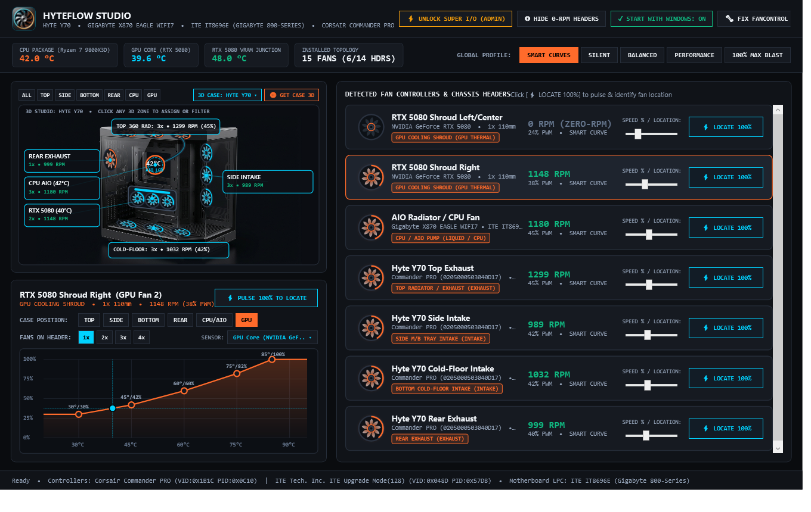
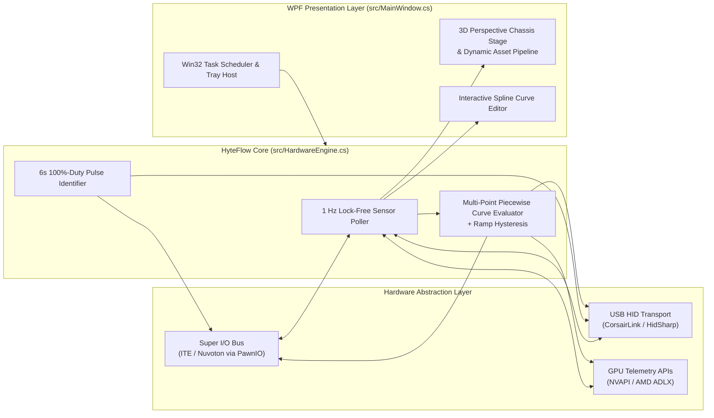

<div align="center">

# HyteFlow Studio

**Universal Windows x64 Hardware Telemetry, Super I/O & USB HID Chassis Fan Controller**

[](https://github.com/harisherry/HyteFlow/releases)
[](https://github.com/harisherry/HyteFlow)
[-0078D6)](https://github.com/harisherry/HyteFlow)
[](https://dotnet.microsoft.com/)
[](LICENSE)

[Features](#-architecture--capabilities) •
[Supported Hardware](#-hardware-compatibility-matrix) •
[Quick Start](#-quick-start) •
[Building from Source](#-building-from-source) •
[User Guide](HOW_TO_USE.md)

</div>

---



**HyteFlow Studio** is a low-overhead, native 64-bit Windows hardware telemetry engine and multi-controller fan curve orchestrator written in C# / WPF. It bridges **Ring-0 motherboard Super I/O registers**, **USB HID fan hubs**, and **vendor GPU APIs (NVAPI / ADLX)** into a unified thermal control plane—mapping anonymous hardware pin headers (`SYS_FAN1`, `Channel #3`) onto an interactive **3D spatial chassis topology** (`TOP`, `SIDE`, `BOTTOM`, `REAR`, `CPU/AIO`, `GPU`).

---

## 🏗 System Architecture & Capabilities



### Core Engineering Highlights

- **Multi-Bus Hardware Abstraction**:
  - **Motherboard Super I/O (`LibreHardwareMonitor` + `PawnIO`)**: Direct register-level PWM duty control and tachometer readback for modern AM5 / LGA1700 / LGA1851 boards—including **ITE (`IT8696E`, `IT8689E`, `IT87952E`)**, **Nuvoton (`NCT6798D`, `NCT6799D`)**, and ACPI Embedded Controllers—compatible with Windows 11 HVCI / Memory Integrity.
  - **USB HID Controllers (`CorsairLink` + `HidSharp`)**: Direct packet-level USB HID communication with **Corsair Commander PRO**, **Commander CORE / XT**, **iCUE LINK System Hub**, and **Hydro Series AIOs**, complete with automatic USB bus re-enumeration recovery and enumeration support for **NZXT**, **Lian Li**, and **HYTE** hubs.
  - **GPU & CPU Thermal Telemetry**: Real-time die, package, and VRAM junction polling for **NVIDIA GeForce (RTX 30/40/50-series)** and **AMD Ryzen / Radeon** sensors.
- **⚡ 1-Click Hardware Header Discovery (`LOCATE 100%`)**:
  - Hardware pins only report bus indices (`FANIN2`, `Channel 4`), not physical mounting positions. Triggering **`⚡ LOCATE 100%`** overrides a single header to 100% PWM for 6 seconds with automatic fail-safe restoration, allowing instant visual/acoustic identification and 1-click spatial zone tagging.
- **Interactive 3D Chassis Viewport & Dynamic Case Catalog**:
  - Renders perspective-foreshortened 3D ARGB fan turbines, AIO pump telemetry, GPU shroud callouts, and splitter/daisy-chain multipliers (`1x`–`4x` physical fans per header) across built-in 3D chassis profiles (`HYTE Y70`, `HYTE Y60`, `Lian Li O11 Dynamic EVO`, `NZXT H9 Flow`, `Corsair 5000D/4000D`) or on-demand web-fetched 3D case renders (`🌐 GET CASE 3D`).
- **Piecewise Linear Thermal Curve Engine**:
  - Interactive drag-and-drop `Temp (°C) × Duty (%)` curve editor (`20°C–95°C`) with live operating crosshair, step-hysteresis smoothing, and composite thermal sources including **`Smart Mix: Max(CPU Package, GPU Core)`**.
- **Zero-Prompt Privilege Elevation at Boot**:
  - Registers an optional `HIGHEST` run-level Windows Scheduled Task (`HyteFlow_UniversalFanControl`) alongside an `HKCU\...\Run` fallback so Super I/O hardware registers unlock silently at Windows logon (`--minimized`) without triggering UAC prompts.

---

## 🔌 Hardware Compatibility Matrix

| Subsystem | Supported Controllers / Chips | Transport / Driver |
| :--- | :--- | :--- |
| **Motherboard Super I/O** | ITE `IT8696E`, `IT8689E`, `IT8688E`, `IT87952E` (Gigabyte B650/B850/X670/X870)<br/>Nuvoton `NCT6798D`, `NCT6799D`, `NCT6791D` (ASUS / MSI / ASRock) | Ring-0 LPC / ISA via `PawnIOLib` & `LibreHardwareMonitorLib` |
| **USB Fan & AIO Hubs** | Corsair Commander PRO, Commander CORE / XT, iCUE LINK Hub, Lighting Node PRO<br/>NZXT Smart Device / Kraken, Lian Li L-Connect HID, HYTE Nexus HID | User-mode USB HID (`HidSharp` / `CorsairLink`) |
| **Graphics Cards** | NVIDIA GeForce RTX 20 / 30 / 40 / 50 Series (Dual Fan & Hotspot/VRAM)<br/>AMD Radeon RX 6000 / 7000 / 9000 Series | `NvAPIWrapper` / `ADLXWrapper` |
| **Processors** | AMD Ryzen 5000 / 7000 / 9000 (`Tctl/Tdie`, CCD)<br/>Intel Core 12th–15th Gen & Core Ultra (Package / Core Max) | CPU MSR / SMU Telemetry |

---

## 🚀 Quick Start

### Option 1: Precompiled Release (Recommended)
1. Download the latest **`HyteFlow-v1.0.0-win-x64.zip`** archive from [**Releases**](https://github.com/harisherry/HyteFlow/releases).
2. Extract the archive and run **`Run-HyteFlow-Admin.bat`** (or launch `HyteFlow.exe` as Administrator so `PawnIO` can unlock motherboard Super I/O registers).

### Option 2: Clone & Run
```powershell
git clone https://github.com/harisherry/HyteFlow.git
cd HyteFlow
powershell -ExecutionPolicy Bypass -File .\build.ps1
.\Run-HyteFlow-Admin.bat
```

> [!NOTE]
> For low-level motherboard Super I/O control on Windows 11 systems with **Hypervisor-Protected Code Integrity (HVCI / Memory Integrity)** enabled, ensure the signed [PawnIO](https://pawnio.eu/) driver is installed. USB HID controllers and GPU telemetry operate in standard user mode without kernel drivers.

---

## 🛠 Building from Source

HyteFlow compiles out-of-the-box on any Windows 10/11 machine with **zero external SDK downloads** using the built-in .NET Framework / Visual Studio Roslyn compiler (`csc.exe`) or MSBuild:

```powershell
# Compile via standalone build script
powershell -ExecutionPolicy Bypass -File .\build.ps1

# Headless verification & automated UI screenshot capture
.\HyteFlow.exe --screenshot docs\preview.png
```

### Repository Structure

```text
HyteFlow/
├── .github/workflows/
│   └── build.yml            # Automated Windows x64 CI build & artifact verification
├── assets/                  # Built-in 3D chassis studio renders & application icons
├── docs/
│   └── preview.png          # High-DPI studio interface capture
├── lib/                     # Hardware telemetry, USB HID & GPU wrapper assemblies
├── src/
│   ├── Program.cs           # STAThread entry point, assembly resolver & CLI flags
│   ├── HardwareEngine.cs    # Super I/O, CorsairLink USB HID & GPU sensor polling engine
│   ├── MainWindow.cs        # WPF 3D viewport compositor, curve editor & HUD controls
│   ├── CustomControls.cs    # Hardware-accelerated WPF vector fan & spline controls
│   ├── CaseCatalog.cs       # 3D chassis spatial presets & web asset fetcher
│   ├── StartupManager.cs    # Windows Task Scheduler (HIGHEST) & Registry auto-start
│   └── Models.cs            # Telemetry, curve serialization & zone topology models
├── build.ps1                # Zero-dependency Roslyn/Framework x64 build script
├── HyteFlow.csproj          # SDK-style .NET 4.8 project definition
├── Run-HyteFlow-Admin.bat   # Elevated launcher for Super I/O register access
├── HOW_TO_USE.md            # Step-by-step operator manual
└── LICENSE                  # MIT License
```

---

## 📖 Documentation

See [**HOW_TO_USE.md**](HOW_TO_USE.md) for the complete operator manual covering 6-second header pulse identification, daisy-chain (`1x`–`4x`) fan topology setup, custom thermal curve tuning, and unattended Windows startup.

## 📄 License

Distributed under the **MIT License**. See [`LICENSE`](LICENSE) for details.
